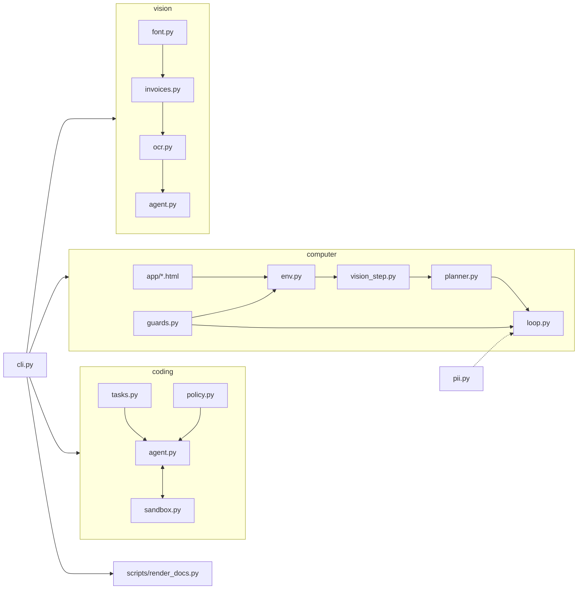

# Architecture

| module | responsibility |
| --- | --- |
| `coding/tasks.py` | 15 tasks with visible and hidden tests |
| `coding/sandbox.py` | temp workspace, path jail, read-only tests, pytest subprocess |
| `coding/policy.py` | localisation and the single-token repair search |
| `coding/agent.py` | the loop, the step cap, trajectory metrics, hidden grading |
| `computer/env.py` | Playwright context, route handler (allowlist, submit gate), coordinate actions |
| `computer/vision_step.py` | screenshot validation and labelled boxes (mock) |
| `computer/planner.py` | guarded and naive planners |
| `computer/guards.py` | allowlist, one-shot approval, untrusted-text wrapper |
| `computer/loop.py` | the screenshot-act loop and 7 scenarios |
| `vision/*` | bitmap font, invoice renderer, template OCR, extraction and escalation |

ADRs: [adr/](adr/).
